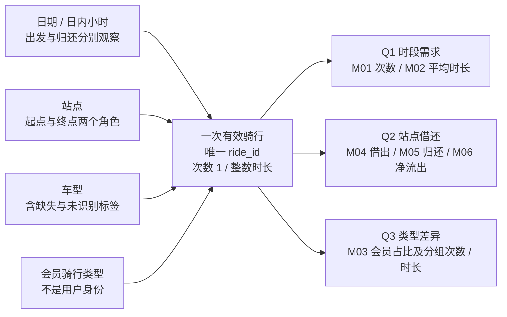

# 概念设计 v1.0：骑行运营分析

阶段 B1（对话二），2026-11-12。状态：B 的设计基线，待 A/C/D 审阅；不是业务签收、建表通过或真实数据验收。

## 业务过程、粒度、维度与事实

按 Kimball 四步法依次作出选择，依据本地《The Data Warehouse Toolkit, 3rd Edition》PDF p62-64、p92-94；总线矩阵依据 p144-145。只引用方法，不把书中业务示例当本项目事实。材料身份见 [原位清单](../../inputs/local-materials.json)。

1. **业务过程：记录一次已结束的共享单车骑行。** 站点借出和归还是同一骑行的两个事件角色，不另造两张明细业务事实。来源范围为官方 JC 发布快照，不推断全纽约业务。
2. **业务粒度：通过准入与去重规则的一次唯一 ride_id。** 原始行与骑行不是同一粒度。构建覆盖取得的全部有效输入，季度和其他窗口在查询时选择，不能在事实层只留下 Q3 出发。
3. **维度：日期、日内小时、站点、车型、会员骑行类型。** 日期/小时有出发与归还角色；站点有起点/终点角色；会员骑行类型不是用户身份。原始源行、文件、构建运行属于治理上下文，不构造分析用户维度。
4. **事实：每次骑行的次数 1 与精确整数微秒时长。** 平均时长、会员占比和净流出是派生计算，不把均值或比例当可加度量存入骑行事实。

## 信息包

| 主题 | 可观察内容 | 维度 / 层次 | 度量或结果 |
|---|---|---|---|
| 历史骑行需求 | 一个有效骑行的发生与时长 | 出发年→季→月→日，日期×小时；车型 | M01 次数、M02 平均分钟 |
| 站点流动 | 同一骑行的借出和归还事件 | 各自事件日期×小时、各自站点、车型 | M04 借出、M05 归还、M06 差值 |
| 骑行类型构成 | member/casual 与车型的骑行差异 | 出发时间、车型、会员骑行类型 | M03 会员骑行占比、分组 M01/M02 |

小时本身是循环类别，不是某月唯一时点；下钻到“小时”必须同时保留日期。星期由日期计算，不等同当地工作日/假日。没有行政区或站点历史映射，不增加城市→区→站点层次。

<!-- diagram: conceptual-model.mmd -->

可编辑图源：[ conceptual-model.mmd ](../../diagrams/conceptual-model.mmd)。

## 分析边界

A v1.0 p1、3、5-7 给出默认 `[2024-07-01, 2024-10-01)`、60 秒至 24 小时（含端点）、无偏移源时间和角色规则。本概念模型保留这些要求。六项指标的精确定义见[模型到指标映射](metric-model-mapping.md)。

未知站点仍属于有效骑行的分析上下文，计入核算总量；坐标不足只限制地图。源行可追溯到文件和处理决定，不因去重或排除而消失。会员标签不支持人数、留存或复购；没有调度/库存数据，净流出不能解释为实时缺车率或库存减少。

当前只有 A PDF；五包真实输入、哈希清单、脚本及逐站基准仍缺。图中关系是设计结论，来源月份规则和数值仍是待 C 核验的 A 声明。下一步的[逻辑设计](logical-design.md)确定关系与键，SQL 类型和部署留到对话三。
