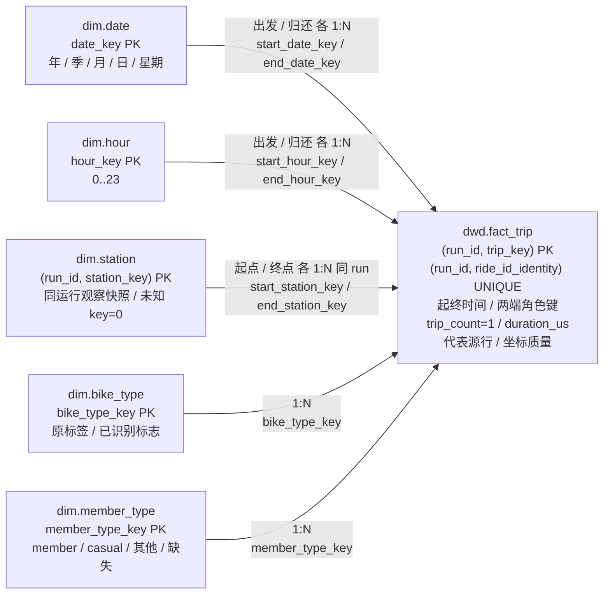
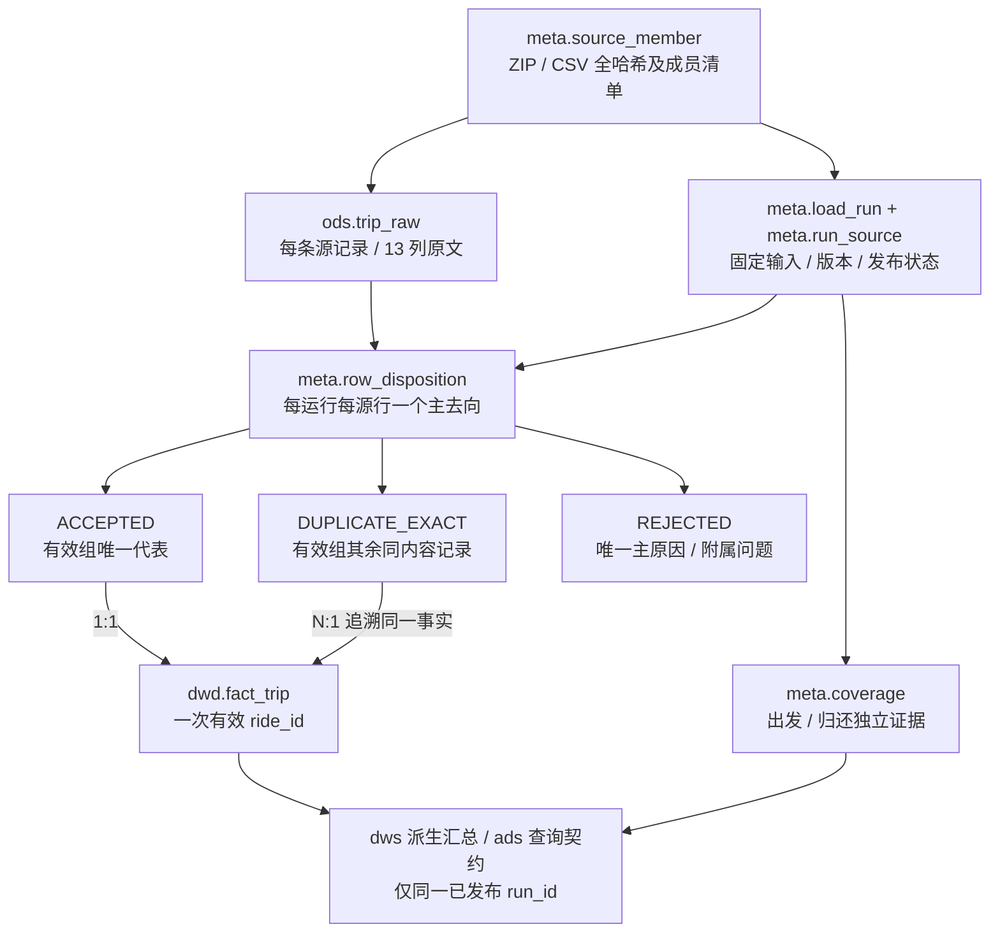

# 逻辑设计 v1.0

阶段 B1，业务规则 A-1.0，处理策略 B1-1.0。一个业务事实，14 个逻辑关系。完整字段与外键见 [JSON 定义](logical-model.json) / [字段字典](data-dictionary.md)。本文件不包含可执行 DDL。

## 总线矩阵

| 业务过程 | 出发日期 | 出发小时 | 归还日期 | 归还小时 | 起点站 | 终点站 | 车型 | 会员骑行类型 |
|---|---|---|---|---|---|---|---|---|
| 一次完成骑行 | X | X | X | X | X | X | X | X |

只有一行真实业务过程。Q1/Q2/Q3 和两个 DWS 汇总是同一过程的消费方式，不伪装成额外业务过程。日期、小时和站点物理上各是一套维度，各列表示角色。

## 星型关系

<!-- diagram: star-schema.mmd -->

可编辑图源：[ star-schema.mmd ](../../diagrams/star-schema.mmd)。

一个 fact 行必须关联每个角色恰好一个维度成员；多条 fact 可关联同一成员，反向为 1:N。站点 FK 含 `run_id`，防止借还角色误连其他构建的展示快照；所有事实关联后计数及 duration_us 不得放大。

## 表级粒度、键与职责

| 关系 | 一行含义 / 关键约束 |
|---|---|
| meta.source_member | 一个 ZIP 哈希内的一个 CSV 成员；UQ(zip_sha256, member_path_identity)，全 ZIP/CSV 哈希可追溯 |
| meta.load_run | 一次固定输入与版本的构建；PK(run_id)；同 scope 至多一个 current 的 PUBLISHED 运行 |
| meta.run_source | 一个运行选择的一个源成员；PK(run_id, source_member_id)，包括空成员 |
| ods.trip_raw | 成员内一条 CSV 数据记录；PK(source_row_id)，UQ(source_member_id, csv_record_number) |
| meta.row_disposition | 每运行每源行唯一主去向；PK(run_id, source_row_id)，同时承担血缘 |
| meta.coverage | 运行×时间角色×覆盖区间；PK(coverage_id)，同角色区间不重叠 |
| dim.date | 一个公历日期，PK(date_key=YYYYMMDD)；没有未知日期，因为事实时间已合法 |
| dim.hour | 日内 0..23 小时，PK(hour_key)；和日期组合才是时点桶 |
| dim.station | 一个运行内一个观察站点 ID，另有未知 key=0；PK(run_id, station_key) |
| dim.bike_type / dim.member_type | 各自一个非空原标签，另有缺失 key=0；原标签精确身份唯一 |
| dwd.fact_trip | 一个运行内一个有效唯一 ride_id；PK(run_id, trip_key)，UQ(run_id, ride_id_identity) |
| dws.trip_hourly | run×出发日×小时×车型×会员类型；次数、总微秒 |
| dws.station_hourly | run×事件日×小时×站点×车型；两侧聚合后的借/还次数 |

`run_id` 是技术版本边界，不是新业务事件。重复运行可以保留不同构建以审计，但查询必须锁定**一个**已发布 run_id；同一 ride_id 不能因跨运行相加而重复计数。将 is_current 切换到新运行前须完成全部校验；失败运行保留诊断，不接管已发布结果。B2 实现唯一 current 与原子切换约束，C 实现加工和发布。

## 业务身份与去重

ID 和标签都保留源非空字符串的精确内容，不转整数、不统一大小写、不偷偷裁掉非空值的首尾字符。空字段或仅 ASCII 空白（空格、TAB、CR、LF）的 ID/标签按缺失处理。精确身份统一为原值 UTF-16LE 无 BOM 的完整字节；必须保留原字符串用于说明。SQL Server 默认字符串比较不够，B2 需落实二进制身份与长度策略。

相同 ride_id 的“同内容”按 **CSV 解析后的 13 个字段文本逐项完全相同**，不先统一时间/数值格式或站名。引用/换行的 CSV 语法只影响解析，单元格内容才参与比较。payload 摘要可加速，但判相等须比较实际字段，不能只相信哈希。此为保守的 B 处理决定，A 附件到齐后若其算法不同须开差异记录，不为匹配 A 数字改数据。

处理顺序、互斥原因与稳定代表选择见[源映射](source-to-target.md)。冲突组全部隔离；同内容有效组恰有一个 ACCEPTED，其余 DUPLICATE_EXACT 都回指同一事实。无效同内容组所有行按同一业务原因 REJECTED，不把无效重复组计为有效骑行。

## 维度与属性策略

- 日期和小时是固定日历描述，星期固定 ISO 1=周一..7=周日，无时区换算。
- 车型/会员类型各保留缺失成员 0。非空未识别标签单独成成员，`is_recognized=false`，不伪装成已知类别；member/casual 的精确标签才进入 M03 已知分母。筛选键由同运行可用字典提供，不靠代理键猜枚举。
- 站点是运行内的**源观察展示快照**，不是业务 SCD2。没有生效起止日期，也不按骑行时点猜历史版本；新运行重新选属性，不改旧运行展示快照。
- 站名从本运行 ACCEPTED 代表行的两端观察中选事件时间最晚的非空名；并列按稳定源行序、再按 start 在 end 前选取。缺名回退站点 ID 并标记；源站名仍完整保留 ODS。
- 参考坐标从同站最晚的有效坐标对独立选择，使用同一并列规则，记录 source_row_id 和角色。它是历史源观察参考点，不称官方现状、不绘制轨迹。两坐标都可解析且在纬度 [-90,90]、经度 [-180,180] 才有效；(0,0) 不凭猜测自动删除，缺区域权威边界时不假设 JC 地理范围。
- 未知站点 key=0、station_id/identity 为 NULL，名称“未知站点”，无参考坐标。两端缺站点都关联它，不能将它当真实地点；核算保留、真实排名/地图单列。

## 原始行、去向与事实关系

<!-- diagram: source-lineage.mmd -->

可编辑图源：[ source-lineage.mmd ](../../diagrams/source-lineage.mmd)。

原始层跨运行复用、不可改写；去向表按运行覆盖全部输入行；只有 ACCEPTED 代表行产生事实。原始副本、无效行和冲突行保留源定位，DUPLICATE_EXACT 与 ACCEPTED 可 N:1 追溯同一事实。事实直接保存代表源行，避免只靠聚合后推断来源。

原始层守恒 `读取行数 = ACCEPTED + DUPLICATE_EXACT + REJECTED`；`有效事实数 = ACCEPTED`。附属 warning_codes 不互斥，不能相加当排除总数。CSV 损坏/字段数不是 13、精度不能无损表达、成员缺失等是**运行发布阻塞**，不增设 A 未约定的业务排除理由。

这些完备性与守恒要求是 VALIDATED/PUBLISHED 的门槛；运行中或失败时允许只有部分诊断和去向，绝不把部分读取的守恒冒充全输入通过。

## 分层与派生结果

ods 保留源，dim 描述角色，dwd 唯一事实，meta 管输入/运行/去向/覆盖，dws 复用总量，ads 表示面向查询的逻辑结果。B1 不要求 DWS/ADS 必须落物理表；B2/C 决定表或视图及执行方式，但粒度和输出不变。

小时 DWS 仅用于由完整小时组成的窗口；任一边界落在小时中间必须回到事实精确筛选，不能取整窗口后直接复用整小时。M06 两侧先按同站/同桶/同车型汇总再全外连接；不允许借/还明细互连。

覆盖不是事实表的 min/max。`meta.coverage` 记录相对已约定 JC 快照的出发/归还覆盖证据，整个请求窗口必须被该角色的 complete 区间并集覆盖。完整空结果可计零；partial/unknown 不能当真实零，具体输出与错误约定见 [C→D 契约](../contracts/c-to-d-query-contract.md)。

## 物理实现

SQL类型、字段上限和索引已落实并在测试库验证，固定五包适配现有定义，见[物理设计](physical-design.md)。C按装载契约实现ETL；实测属性与接入事项见[属性表](open-attributes.md)。
