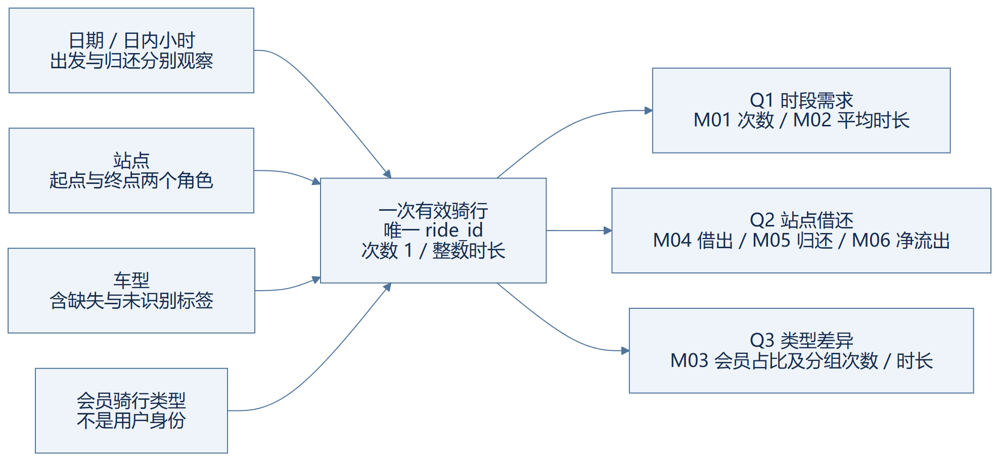

# 3 概念设计

## 3.1 设计依据与业务过程

本系统面向共享单车历史骑行运营分析，围绕时段需求、站点借还和会员骑行类型差异组织数据。业务需求依据《共享单车 A 部分立项与需求分析 v1.0》第 3、5—7 页；数据范围为官方 JC 分区历史发布快照，不能推断为完整纽约网络。默认分析窗口为源时间 `[2024-07-01 00:00:00, 2024-10-01 00:00:00)`，同时保留其他取得输入以支持跨月边界核验。

采用 Kimball 维度建模四步法，依次选择业务过程、声明粒度、确定维度、确定事实。方法定位见原位《The Data Warehouse Toolkit, 3rd Edition》PDF 页序 62—64、92—94；本项目的选择如下。

第一，业务过程为“一次已完成的共享单车骑行”。借出与归还是这次骑行的两个事件角色，因此用一个原子骑行事实支持两个方向的分析，避免维护两套不一致的骑行明细。

第二，事实粒度为“一次构建运行内，一条满足分析规则的唯一 ride_id”。准入条件是 ID 非空、起止时间可解析、时长在 60 秒至 24 小时之间且包含端点；同 ID 同内容留一条，同 ID 内容冲突整组隔离。原始源记录与有效骑行的粒度不同，原始层保留全部记录及处理去向。事实覆盖取得的全部有效输入，季度限制在查询阶段生效。

第三，维度包括日期、日内小时、站点、车型和会员骑行类型。日期与小时分别承担出发和归还角色，站点分别承担起点和终点角色。会员骑行类型仅描述 member/casual 等源标签，不包含用户身份，不能据此计算人数、留存或复购。

第四，原子事实保存次数 1 和整数微秒时长。平均时长、会员占比与净流出由当前范围的基础分子分母派生，不将均值或比例作为可加事实累加。

## 3.2 信息包与分析维度

表 3-1 按业务问题组织信息包，概念关系见图 3-1。

| 业务问题 | 维度与层次 | 可观察度量 | 使用边界 |
|---|---|---|---|
| Q1 时段需求 | 出发年→季→月→日，日期×小时；车型 | M01 骑行次数、M02 平均分钟 | 星期×小时折叠多个日期；星期不等于节假日或工作日 |
| Q2 站点借还 | 各自事件日期×小时、各自站点、同一车型条件 | M04 借出、M05 归还、M06 净流出 | 两侧事件独立筛选后聚合，不要求同骑行两端在窗口内 |
| Q3 类型差异 | 出发时间、会员骑行类型、车型 | M03 会员占比及分组次数/时长 | 会员占比仅以可识别 member/casual 为分母，另报识别覆盖率 |

图 3-1 骑行业务概念模型。可编辑[图源](../../diagrams/conceptual-model.mmd)及[矢量版](../../diagrams/exports/conceptual-model.svg)。箭头表示分析组织关系，不表示已完成 ETL。

日内小时是 0—23 的循环类别，必须与日期组合才构成具体时点桶。未提供站点行政区或历史行政映射，不扩展“城市→区→站点”层次。站点名称与参考坐标取自本次输入的源观察，不宣称为官方现状或业务历史版本。

## 3.3 事件角色与可加性

设 F 为一个已发布运行的全部有效骑行；在共同车型条件 B 下，出发集合 S 为 `L <= started_at < U` 的记录，归还集合 E 为 `L <= ended_at < U` 的记录。M01—M04 使用 S，M05 使用 E，M06 对两侧按相同站点和事件桶汇总后作差。E 可以包含窗口前出发的骑行，S 可以包含窗口后归还的骑行。

次数和总微秒可对互斥集合求和。M02 使用 `总微秒 / 60000000 / 总次数`，M03 使用 `member 次数 / (member 次数 + casual 次数)`；跨日期或类型汇总时重新计算分子分母，不能平均月均值或月占比。分母为零返回 NULL。

站点净流出属于样本骑行的借还事件差，可能为正、负或零。没有车辆库存与运维调度数据，不能把它解释为库存变化、实时缺车率或真实供需缺口；源坐标也不能组成真实骑行轨迹或距离。

## 3.4 未知成员、覆盖与证据边界

缺少站点 ID 的有效骑行映射到专用未知成员并保留核算总量。真实站点排名和地图单列未知，缺坐标仅限制地图，不删除骑行。车型或会员类型的非空未识别标签单独保留，不能强行归为已知类型。

查询空集合与数据覆盖不足需要区分。只有请求窗口被对应时间角色的完整覆盖证据覆盖，零事件才可解释为真实零；平均值和比例的空分母仍为 NULL。部分覆盖或无覆盖返回不足状态，不输出权威零。

A 第 3 页声明五个月包按结束月份划分，需 C 对原 ZIP 全部成员、全部记录核验。若该归档规则成立且最长准入时长为 24 小时，则结束事件覆盖 `[L,U)` 可支持归还窗口；结束事件完整覆盖 `[L,U+24小时)` 是出发窗口的一个保守充分条件。故不能仅凭 7—9 月文件名证明 Q3 出发完整，10 月边界包需要保留，6 月包依 A 要求作前边界检查。

截至 2026-11-13，已收到 A 的 PDF，未收到其原数据包、哈希清单、核验脚本和逐站基准。官方页面与局部表头核验只确认来源/字段说明，不能证明全量输入或 A 的 334,332 等业务数值。本章交付的是业务概念设计；真实输入与六指标复核属于后续联合验收。

设计定位：[概念设计基线](../design/conceptual-design.md)、[A 交付审查](../review/a-delivery-review.md)、[来源核验](../sources/official-sources.md)。原材料身份和方法抽读范围见[材料清单](../../inputs/local-materials.json)。
