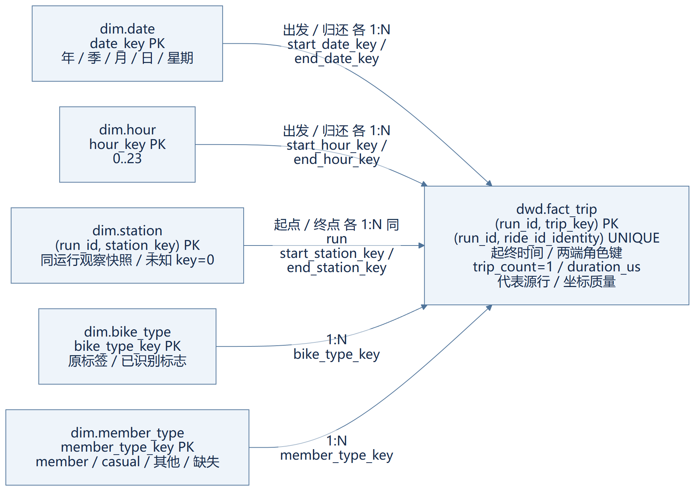
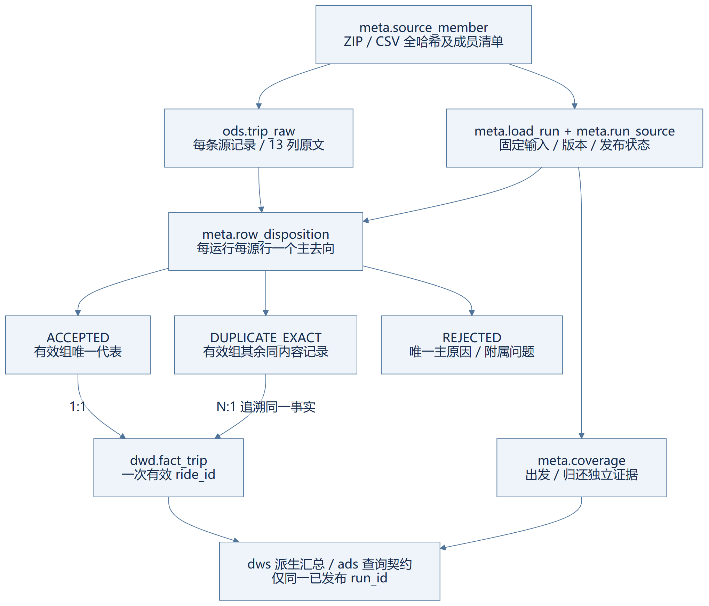

# 4 逻辑设计

## 4.1 总线矩阵与星型模型

依据第 3 章的单一骑行业务过程，构建一个原子事实和五类维度。总线矩阵仅列一个真实过程；Q1—Q3 是消费需求，DWS 是派生汇总，均不另作业务过程。

| 业务过程 | 出发日期 | 出发小时 | 归还日期 | 归还小时 | 起点站 | 终点站 | 车型 | 会员骑行类型 |
|---|---|---|---|---|---|---|---|---|
| 一次完成骑行 | X | X | X | X | X | X | X | X |

图 4-1 骑行事实角色星型模型。日期/小时/站点的两角色合并标注在同一条边上，箭头由唯一维度成员指向多条事实，各角色均为 1:N；站点关联还必须匹配 run_id。图只显示核心分析关系，完整 31 个外键见[逻辑清单](../design/logical-model.json)。[图源](../../diagrams/star-schema.mmd) / [SVG](../../diagrams/exports/star-schema.svg)。

`dwd.fact_trip` 的主键为 `(run_id, trip_key)`，同运行业务身份 `(run_id, ride_id_identity)` 唯一。日期、小时与站点均通过不同外键扮演两端角色，无需复制两份维度定义。每条事实对每个角色恰好匹配一个成员，维度关联前后次数、行数与总微秒应保持不变。

## 4.2 关系粒度与键

模型共 14 个关系、132 个字段，涵盖分析星型及来源治理。表 4-1 列出各关系的粒度与关键身份；132 字段的含义、NULL 和全部关系保留在[数据字典](../design/data-dictionary.md)，不以示意图代替完整结构。

| 关系 | 一行粒度 | 主键 / 重要唯一性 |
|---|---|---|
| meta.source_member | 一个 ZIP 内的一个 CSV 成员 | source_member_id；ZIP 哈希+精确成员路径唯一 |
| meta.load_run | 一次固定输入/代码/规则版本构建 | run_id；同 scope 至多一个 current PUBLISHED |
| meta.run_source | 一运行选择的一源成员 | run_id+source_member_id，包括零数据成员 |
| ods.trip_raw | 一个成员中的一条 CSV 数据记录 | source_row_id；source_member_id+csv_record_number 唯一 |
| meta.row_disposition | 一运行内一源行的主去向 | run_id+source_row_id |
| meta.coverage | 一运行、一时间角色的一个证据区间 | coverage_id；同角色区间不重叠 |
| dim.date | 一个公历日期 | date_key=YYYYMMDD；calendar_date 唯一 |
| dim.hour | 一个日内小时 | hour_key，0—23 |
| dim.station | 一运行内一个站点观察快照 | run_id+station_key；run_id+station_id_identity 唯一 |
| dim.bike_type | 一个精确车型标签，另有缺失成员 | bike_type_key；bike_type_identity 唯一 |
| dim.member_type | 一个精确会员骑行标签，另有缺失成员 | member_type_key；member_type_identity 唯一 |
| dwd.fact_trip | 一运行内一条有效唯一骑行 | run_id+trip_key；run_id+ride_id_identity 唯一 |
| dws.trip_hourly | 运行×出发日×小时×车型×会员类型 | 五列组合键；次数、总微秒 |
| dws.station_hourly | 运行×事件日×小时×站点×车型 | 五列组合键；借出、归还次数 |

`run_id` 是技术构建边界，不能把多个运行当不同骑行重复相加。查询开始时解析一个 PUBLISHED 运行并固定在整次请求中；旧运行保留用于审计，不与新运行混算。

业务 ID 和标签保留非空原字符串，不转整数、不忽略大小写、不裁非空值首尾字符。精确身份定义为原字符串完整 UTF-16LE 字节且无 BOM；空字段或仅由空格/TAB/CR/LF 组成的 ID/标签按缺失处理。哈希可用于候选分组加速，不能替代实际字段等值比较。

## 4.3 维度属性与未知成员

日期属性包括年、季、月、日和固定 ISO 星期（周一为 1，周日为 7），不依赖连接会话 DATEFIRST。小时维度保存 24 个成员。事实两端时间合法，因此不设置未知日期；缺少站点或类型可使用对应未知成员 0。

站点采用每运行的源观察展示快照，主外键都包含 run_id。站名从该运行 ACCEPTED 代表行的两端观察中选事件时间最晚的非空名称；并列按稳定源序，再按 start 先于 end。参考坐标从同站最晚的有效坐标对独立选择，保留源行及角色。无名回退站点 ID 并标记；无 ID 即使有名称仍为未知站点。该策略没有业务生效/失效时间，不称 SCD2。

坐标须成对可解析且纬度在 [-90,90]、经度在 [-180,180]；按缺失、非数值、越界、有效的优先级标记状态。无效一侧解析坐标均为空，但原文保留 ODS。不凭猜测剔除 (0,0)，也不使用未经证实的 JC 区域边界裁数据。

车型和会员类型分别保留原标签、展示名、未知和已识别标志。只有精确 member/casual 进入 M03 分母；非空新标签保持独立成员。代理键为实现身份，消费方应取运行可用字典，不用键值猜标签。

## 4.4 源映射、去重与血缘

官方当前结构为 13 列：ride_id、rideable_type、started_at、ended_at、start_station_name、start_station_id、end_station_name、end_station_id、start_lat、start_lng、end_lat、end_lng、member_casual。五包另有5个AppleDouble元数据成员，验证后单列哈希，不进入CSV记录数/ODS。真正骑行CSV的这些字段按原顺序进入 `raw_values` 及同名 `_raw` 列。CSV 空单元格保留空字符串；无法安全解析、列数不符或读取不完整会阻止运行发布。

ID 映射到事实/维度精确身份；起止时间映射到事实与各自日期/小时键并产生整数微秒；两端站点 ID 映射站点键；名称/坐标成为观察属性和质量信息；车型/会员标签映射对应维度。完整逐列规则见[源到目标映射](../design/source-to-target.md)。

同 ride_id 的“同内容”以 CSV 解析后的全部 13 个单元格原文本逐项相同为准，不先规范化时间或数值格式。处理优先级为：缺 ID→同 ID 内容冲突→时间解析失败→非正时长→短于 60 秒→长于 24 小时→有效组代表。冲突整组排除；同内容有效组按 ZIP 哈希、成员路径 UTF-8 字节序、CSV 记录号选一条稳定代表，其余完全重复行追溯同一事实。无效同内容组全部排除。

图 4-2 记录级血缘与覆盖关系。[图源](../../diagrams/source-lineage.mmd) / [SVG](../../diagrams/exports/source-lineage.svg)。ACCEPTED、DUPLICATE_EXACT、REJECTED 是去向表内互斥分类，图中分类节点不是新增物理表。

CSV 表头为记录 1，首数据记录为 2；含引号换行的一个 CSV 记录可能跨多个物理行。源定位由 ZIP/CSV 完整哈希、成员路径、CSV 记录号组成，不能把代理键当源行号。全输入守恒为 `N_raw = N_ACCEPTED + N_DUPLICATE_EXACT + N_REJECTED`，`N_fact = N_ACCEPTED`。附属 warning 可重叠，不参与互斥排除总和。每事实必须恰有一个匹配的接受代表，重复行指同一事实与代表，排除行不指事实。

## 4.5 六指标与分层消费

表 4-2 给出统一运行、窗口与车型条件下的模型计算路径。

| 指标 | 时间与字段 | 计算 / 约束 |
|---|---|---|
| M01 次数 | started_at、trip_count | 出发集合次数之和 |
| M02 平均分钟 | started_at、duration_us | 总微秒 / 60000000 / 次数；零分母 NULL |
| M03 会员占比 | started_at、member_type | member / (member+casual)；另报 known/全部次数 |
| M04 借出 | started_at、start_station_key | 按起点及出发事件桶计数；全站含未知合计等于 M01 |
| M05 归还 | ended_at、end_station_key | 按终点及归还事件桶计数；包含窗口前出发 |
| M06 净流出 | 两侧角色 | 两侧分别聚合到相同站点/桶/车型，再 FULL OUTER JOIN 作借出减归还 |

ODS 保留所有原始记录；DIM 描述角色；DWD 保存唯一原子事实；META 保存输入、版本、去向、覆盖与发布；DWS 保存可复用的基础加总；ADS 按契约组织结果。物理设计已将两个 DWS 落表，ADS 目前只有 schema 和命名结果约定，业务查询由 C 实现。

小时 DWS 只直接服务完整小时窗口。请求边界在小时内部或筛选不被该粒度保留时，回到事实精确筛选。M06 不直接连接借还明细，缺某侧仅在该侧完整覆盖时补 0；两角色覆盖不足不能输出权威差值。

逻辑模型已覆盖六项指标，结构和部分边界已在独立测试库验证，但新公开五包的真实值域/月份关系与38项源数值已核验，见[来源补充](../sources/public-snapshot-validation.md)；完整ETL、六查询及仓库对源对账仍待C验证。具体查询字段、排序、NULL 与元信息见 [C→D 契约](../contracts/c-to-d-query-contract.md)，真实验收清单见[最终交接](../handoff/acceptance-checklist.md)。
